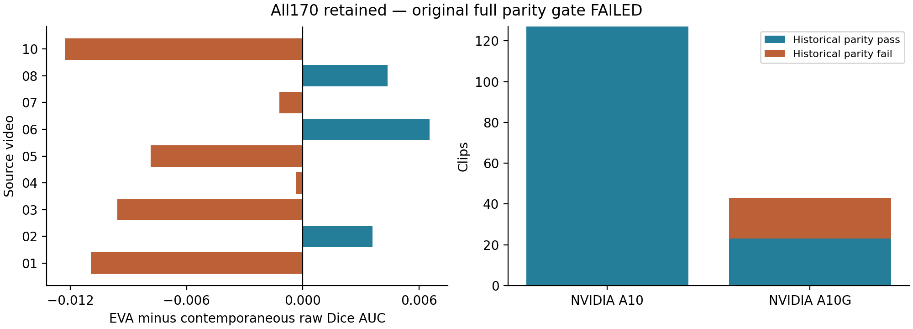
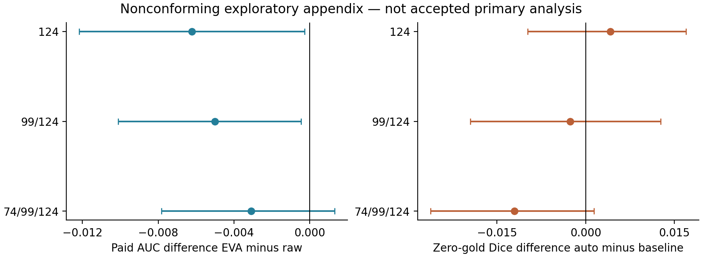
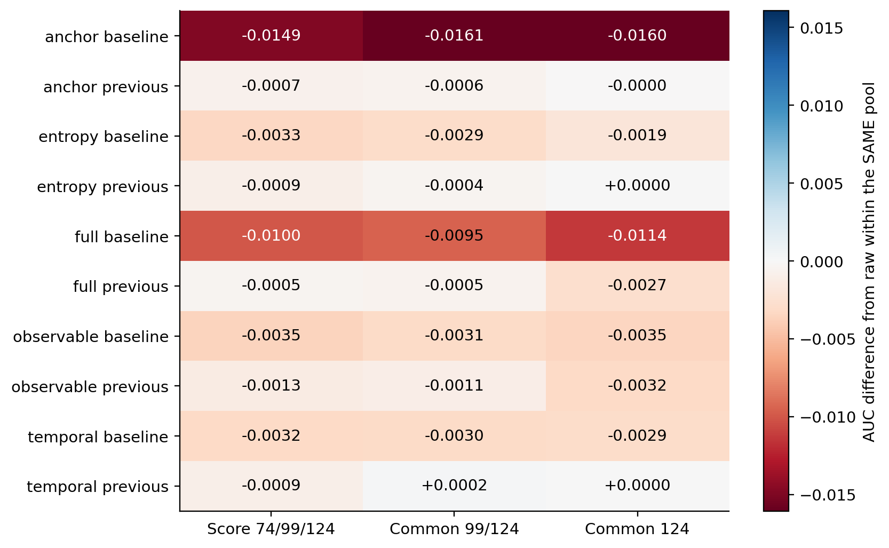

# Phân tích đầy đủ đối chứng correction và giới hạn tái lập trong video phụ khoa

Đã thu đủ 170 bộ kết quả huấn luyện thuộc chín video nguồn, gồm 161 lượt thực thi mới và chín clip đại diện tái sử dụng. Tuy nhiên, kiểm tra tái lập raw so với factorized bank lịch sử chỉ đạt 150 trên 170 clip. Hai mươi clip không đạt ngưỡng đã đăng ký, trong đó ba clip có query trajectory khác. Vì vậy, báo cáo này giữ nguyên kết luận gate chính thất bại và trình bày kết quả toàn bộ 170 clip như một phụ lục exploratory không phù hợp đầy đủ protocol ban đầu. Có đủ file kết quả không đồng nghĩa thí nghiệm đã đạt toàn bộ điều kiện chấp nhận.

Kiểm tra độc lập cấu trúc cho cả 170 clip xác nhận đúng nguồn, checksum input và output, ngân sách mask, scoring pool, số liệu hữu hạn và cùng hardware giữa các phương pháp trong từng clip. Các đối chứng mới được so với raw của chính lượt chạy hiện tại; không dùng raw bank cũ làm đối chứng ghép cặp cho chúng. Không loại 20 clip bất lợi hoặc chạy lại theo hardware để cải thiện hiệu quả, không nới tolerance và không chuyển các kết quả này thành validation độc lập.

## Ý nghĩa khoa học chính

EVA adaptation có AUC trung bình thấp hơn raw hiện tại khoảng 0,00308; CI mô tả bao gồm 0 và chỉ ba trong chín nguồn có chênh lệch dương. Control dùng prompt dự đoán tự động có Dice trung bình thấp hơn baseline không dùng gold khoảng 0,01207, CI cũng bao gồm 0. Các kết quả không ủng hộ tuyên bố một allocator vượt trội. Mười ablation trước đó trên 170 clip cũng có trung bình AUC dưới raw ở scoring pool gốc. Bằng chứng có giá trị nhất hiện tại là phân tích giới hạn của verification, fallback, prompt tự động và độ nhạy tái lập theo hardware trong cấu hình đã khảo sát.

## Thiết kế và phạm vi so sánh

Giữ nguyên checkpoint framewise và SAM2 Tiny, query 0/24/49 và score 74/99/124,125 frame 25 fps, hai binary target tử cung và union dụng cụ theo nhãn phát hành. Raw và EVA mua năm mask đầy đủ có tính cả khởi tạo; AUC chuẩn hóa tại ngân sách 0/1/2/5 có trọng số 0,1/0,2/0,4/0,3. EVA dùng QNet pretrained chính thức được strict-load với current paid-state mask embedding và farthest-distance selection, thích nghi mask-only/SAM2; không phải tái lập hệ EVA RL/MiVOS gốc. Supervision QNet bổ sung và exposure chưa xác định được công bố.

Control lấy cảm hứng SASVi dùng dự đoán baseline, reset độc lập theo từng semantic head ở đoạn 25 frame và foreground presence bền bốn frame; không có mask gold. Nó được chấm bằng endpoint riêng, không có paid-mask AUC và không phải hệ SASVi gốc. Xử lý theo đoạn, lookahead và scope semantic union được giữ rõ; không suy thành causal streaming hay an toàn phẫu thuật.

Trung bình clip trong nguồn rồi cân bằng chín nguồn;2.000 paired source-bootstrap seed 20261019. Chín nguồn không phải 170 bệnh nhân độc lập. Các CI là mô tả, nhiều comparison và lịch sử development ngăn diễn giải confirmatory. Validation 57 clip chưa chạy và final test 73 clip vẫn khóa.

## Kết quả paid mask trên toàn bộ cohort exploratory

| pool | mode | dice_auc | delta_vs_contemporaneous_raw | lower95 | upper95 | positive_sources |
| --- | --- | --- | --- | --- | --- | --- |
| original | raw | 0.892098 | 0.000000 | 0.000000 | 0.000000 | 0 |
| original | eva_qnet_mask_adaptation | 0.889018 | -0.003079 | -0.007819 | 0.001327 | 3 |
| late_common | raw | 0.886752 | 0.000000 | 0.000000 | 0.000000 | 0 |
| late_common | eva_qnet_mask_adaptation | 0.881752 | -0.005000 | -0.010106 | -0.000457 | 3 |
| last_common | raw | 0.878662 | 0.000000 | 0.000000 | 0.000000 | 0 |
| last_common | eva_qnet_mask_adaptation | 0.872449 | -0.006213 | -0.012174 | -0.000259 | 2 |

So sánh này giữ nguyên mọi nguồn và mọi clip; raw hiện tại có AUC 0,892098, khác raw bank cũ 0,893236. Không thay hai giá trị cho nhau. Ngay cả khi hiệu ứng EVA dương tại một vài nguồn, CI và protocol deviation không cho phép tuyên bố superiority, equivalence hay khái quát sang hệ EVA gốc.

## Hiệu ứng tại từng video nguồn

| procedure_id | eva_qnet_mask_adaptation | raw | delta | clips |
| --- | --- | --- | --- | --- |
| AutoLaparo_video_01 | 0.858721 | 0.869677 | -0.010956 | 37 |
| AutoLaparo_video_02 | 0.937513 | 0.933928 | 0.003584 | 21 |
| AutoLaparo_video_03 | 0.857158 | 0.866732 | -0.009574 | 27 |
| AutoLaparo_video_04 | 0.924716 | 0.925046 | -0.000330 | 19 |
| AutoLaparo_video_05 | 0.916414 | 0.924274 | -0.007859 | 11 |
| AutoLaparo_video_06 | 0.860623 | 0.854075 | 0.006548 | 22 |
| AutoLaparo_video_07 | 0.912106 | 0.913326 | -0.001221 | 8 |
| AutoLaparo_video_08 | 0.896292 | 0.891915 | 0.004378 | 14 |
| AutoLaparo_video_10 | 0.837621 | 0.849906 | -0.012286 | 11 |

## Control tự động không dùng gold mask

| pool | dice | baseline_dice | delta | lower95 | upper95 | positive_sources |
| --- | --- | --- | --- | --- | --- | --- |
| original | 0.791402 | 0.803468 | -0.012065 | -0.026281 | 0.001406 | 3 |
| late_common | 0.795524 | 0.798116 | -0.002592 | -0.019495 | 0.012733 | 4 |
| last_common | 0.794269 | 0.790052 | 0.004218 | -0.009833 | 0.016992 | 5 |

Baseline tại ngân sách 0 có Dice 0,803468 trong pool gốc, còn control tự động 0,791402. Prompt dự đoán có thể truyền lỗi sang scoring frame nhưng thí nghiệm không cô lập nguyên nhân. Không so tốc độ hoặc chất lượng zero-gold endpoint như thể nó cùng nhiệm vụ với năm mask gold. Không thay prompt dự đoán bằng reference để cứu kết quả.

## Kiểm tra tái lập và sai khác theo hardware

| actual_gpu | clips | parity_pass | query_same | maximum_metric_drift | maximum_auc_bound | parity_fail |
| --- | --- | --- | --- | --- | --- | --- |
| NVIDIA A10 | 127 | 127 | 127 | 0.000308 | 0.000084 | 0 |
| NVIDIA A10G | 43 | 23 | 40 | 0.229003 | 0.137751 | 20 |

Tổng 127 clip chạy A10 và 43 clip A10G; tất cả phương pháp trong mỗi clip dùng cùng hardware. Hai mươi failure đều ở A10G, nhưng 23 clip A10G vẫn qua gate. Điều này là association trong lượt thực thi, chưa chứng minh hardware là nguyên nhân duy nhất. Khác biệt số nhỏ có thể làm thay đổi thứ tự chọn mask, nên sai khác query có thể khuếch đại endpoint. Ba clip 044/132/148 có query trajectory khác bank;132 có metric drift tối đa 0,229003 và AUC bound 0,137751. Không gọi đây chỉ là roundoff không đáng kể.

Ngưỡng cũ maximum metric difference 0,001 và AUC bound 0,0001 được giữ nguyên. Gate chính vẫn thất bại 150/170; kiểm tra cấu trúc độc lập 170/170 là tiêu chí khác và không ghi đè gate đó. Không đưa summary này vào báo cáo như một primary analysis đã được chấp nhận. Các failure được lưu để nghiên cứu tái lập và xây dựng nghiên cứu xác nhận mới, không để chọn subset có lợi.

## Phân tầng hardware sau khi phát hiện lỗi tái lập

| actual_gpu | pool | clips | sources | raw_auc | eva_auc | delta |
| --- | --- | --- | --- | --- | --- | --- |
| NVIDIA A10 | last_common | 127 | 9 | 0.874177 | 0.869019 | -0.005158 |
| NVIDIA A10 | late_common | 127 | 9 | 0.885885 | 0.881175 | -0.004711 |
| NVIDIA A10 | original | 127 | 9 | 0.892852 | 0.890116 | -0.002736 |
| NVIDIA A10G | last_common | 43 | 8 | 0.838391 | 0.831161 | -0.007231 |
| NVIDIA A10G | late_common | 43 | 8 | 0.859165 | 0.853829 | -0.005336 |
| NVIDIA A10G | original | 43 | 8 | 0.866367 | 0.857405 | -0.008963 |

Phân tầng này được khai báo sau khi thấy lỗi parity, trước khi xem hiệu quả đối chứng mới. Mỗi tầng cân bằng các nguồn đóng góp trong tầng đó; thành phần nguồn và độ khó khác nhau nên không xem chênh lệch giữa hai tầng là tác động nhân quả của GPU. Không dùng tầng có kết quả thuận lợi hơn làm kết quả chính.

## Compute và bộ nhớ thực đo

| mode | clips | seconds_median | seconds_min | seconds_max | allocated_GiB_max | reserved_GiB_max |
| --- | --- | --- | --- | --- | --- | --- |
| constant_reject_software | 9 | 80.514743 | 77.357908 | 86.621898 | 0.758186 | 0.902344 |
| eva_qnet_mask_adaptation | 170 | 47.789568 | 42.745430 | 58.150553 | 0.844459 | 0.986328 |
| raw | 170 | 46.934227 | 41.472581 | 58.791099 | 0.754619 | 0.917969 |
| sasvi_predicted_adaptation | 170 | 18.065409 | 15.540264 | 22.101540 | 0.658138 | 0.826172 |
| uniform | 9 | 45.194147 | 41.312215 | 48.656800 | 0.758186 | 0.902344 |

Raw trung vị 46,93 giây và EVA47,79 giây trên 170 clip; control tự động 18,07 giây. Initialization được tính, baseline/JPEG đã chuẩn bị từ trước không được tính. Thứ tự cố định và một lượt chạy không xác lập lợi thế latency nhân quả. Các peak allocated/reserved chỉ thuộc allocator PyTorch; host RSS high-water là cộng dồn process, không phải peak riêng từng phương pháp. Uniform và constant-reject compute chỉ có chín clip đại diện, không được báo như coverage 170. Không quy đổi gold callback thành thời gian bác sĩ.

## Ablation cơ chế đã hoàn tất trước đợt chạy đối chứng

### Thiết kế ablation và hai fallback

Cùng query trajectory raw, cùng labels, cùng source-balanced Ridge alpha 10/threshold 0 và LOSO. Mỗi fold chỉ fit trên tám nguồn khác, scaler fit trong training. Metadata target/ngân sách/thời gian có ở mọi nhóm; nhóm entropy thêm entropy/baseline entropy/ROI entropy, temporal thêm khoảng cách tới mask đã mua và temporal consistency, anchor thêm leave-one-prompt-out reconstruction và support flag. Observable loại toàn bộ anchor; full giữ toàn bộ. Không search family/threshold. Nhánh fallback giữ output trước hoặc quay về baseline khi reject. Quyết định tiếp theo dùng output đang giữ, nên hai fallback cũng thay đổi reference features về sau.

| pool | method | dice_auc | delta | lower95 | upper95 | positive_sources | sources |
| --- | --- | --- | --- | --- | --- | --- | --- |
| original | anchor_baseline | 0.878310 | -0.014926 | -0.019778 | -0.009299 | 1 | 9 |
| original | anchor_previous | 0.892551 | -0.000685 | -0.001706 | 0.000313 | 1 | 9 |
| original | entropy_baseline | 0.889969 | -0.003267 | -0.004971 | -0.001743 | 0 | 9 |
| original | entropy_previous | 0.892300 | -0.000936 | -0.002621 | 0.000612 | 1 | 9 |
| original | full_baseline | 0.883272 | -0.009964 | -0.014683 | -0.005849 | 1 | 9 |
| original | full_previous | 0.892743 | -0.000493 | -0.002278 | 0.000786 | 4 | 9 |
| original | observable_baseline | 0.889697 | -0.003539 | -0.004374 | -0.002594 | 0 | 9 |
| original | observable_previous | 0.891892 | -0.001344 | -0.003594 | 0.000373 | 4 | 9 |
| original | raw | 0.893236 | 0.000000 | 0.000000 | 0.000000 | 0 | 9 |
| original | temporal_baseline | 0.890057 | -0.003179 | -0.004938 | -0.001374 | 1 | 9 |
| original | temporal_previous | 0.892321 | -0.000915 | -0.002520 | 0.000680 | 3 | 9 |

Trong cấu hình đã định, cả mười biến thể có mean AUC thấp hơn raw. Giữ output trước tốt hơn quay về baseline ở từng nhóm tín hiệu xét theo source-macro mean. Kết quả này làm rõ rằng một cơ chế phát hiện cập nhật không tốt vẫn có thể gây mất chất lượng nếu hành động thay thế cũng yếu. Nó không chứng minh một nhóm feature không có thông tin ở mọi model, không xác định nguyên nhân nhân quả và không cho phép chọn lại biến thể thuận lợi rồi gọi là candidate đã xác nhận.

### So sánh trực tiếp hai fallback

| pool | group | previous_minus_baseline | lower95 | upper95 | positive_sources |
| --- | --- | --- | --- | --- | --- |
| original | entropy | 0.002331 | -0.000067 | 0.005180 | 7 |
| original | temporal | 0.002264 | 0.000342 | 0.004209 | 8 |
| original | anchor | 0.014241 | 0.008873 | 0.018980 | 8 |
| original | observable | 0.002195 | 0.000298 | 0.003915 | 7 |
| original | full | 0.009471 | 0.005524 | 0.014193 | 8 |

## Sensitivity temporal với scoring pool chung

Chấm thêm trên pool 99/124 và pool 124 cho mọi phương pháp, không loại frame khác nhau theo query được từng policy chọn. Query pool và ngân sách giữ nguyên. Mỗi contrast so với raw trong chính pool đó; tuyệt đối không chọn pool tốt nhất hoặc so endpoint tuyệt đối giữa các pool như một phép kiểm định tương đương. Kết quả ở frame cuối chỉ là một snapshot/target/clip, không phải tracking dày.

| pool | method | dice_auc | delta | lower95 | upper95 | positive_sources | sources |
| --- | --- | --- | --- | --- | --- | --- | --- |
| original | anchor_baseline | 0.878310 | -0.014926 | -0.019778 | -0.009299 | 1 | 9 |
| original | anchor_previous | 0.892551 | -0.000685 | -0.001706 | 0.000313 | 1 | 9 |
| original | entropy_baseline | 0.889969 | -0.003267 | -0.004971 | -0.001743 | 0 | 9 |
| original | entropy_previous | 0.892300 | -0.000936 | -0.002621 | 0.000612 | 1 | 9 |
| original | full_baseline | 0.883272 | -0.009964 | -0.014683 | -0.005849 | 1 | 9 |
| original | full_previous | 0.892743 | -0.000493 | -0.002278 | 0.000786 | 4 | 9 |
| original | observable_baseline | 0.889697 | -0.003539 | -0.004374 | -0.002594 | 0 | 9 |
| original | observable_previous | 0.891892 | -0.001344 | -0.003594 | 0.000373 | 4 | 9 |
| original | raw | 0.893236 | 0.000000 | 0.000000 | 0.000000 | 0 | 9 |
| original | temporal_baseline | 0.890057 | -0.003179 | -0.004938 | -0.001374 | 1 | 9 |
| original | temporal_previous | 0.892321 | -0.000915 | -0.002520 | 0.000680 | 3 | 9 |
| late_common | anchor_baseline | 0.871449 | -0.016061 | -0.022834 | -0.008845 | 1 | 9 |
| late_common | anchor_previous | 0.886939 | -0.000571 | -0.001954 | 0.000808 | 1 | 9 |
| late_common | entropy_baseline | 0.884569 | -0.002941 | -0.004737 | -0.001349 | 0 | 9 |
| late_common | entropy_previous | 0.887123 | -0.000387 | -0.002147 | 0.001376 | 1 | 9 |
| late_common | full_baseline | 0.878056 | -0.009454 | -0.016417 | -0.003913 | 1 | 9 |
| late_common | full_previous | 0.886971 | -0.000539 | -0.002739 | 0.001099 | 4 | 9 |
| late_common | observable_baseline | 0.884426 | -0.003084 | -0.004212 | -0.001940 | 0 | 9 |
| late_common | observable_previous | 0.886424 | -0.001086 | -0.003764 | 0.000702 | 3 | 9 |
| late_common | raw | 0.887510 | 0.000000 | 0.000000 | 0.000000 | 0 | 9 |
| late_common | temporal_baseline | 0.884481 | -0.003029 | -0.005215 | -0.000750 | 2 | 9 |
| late_common | temporal_previous | 0.887662 | 0.000152 | -0.000962 | 0.001405 | 4 | 9 |
| last_common | anchor_baseline | 0.862697 | -0.015954 | -0.025769 | -0.006066 | 1 | 9 |
| last_common | anchor_previous | 0.878648 | -0.000003 | -0.002343 | 0.003012 | 1 | 9 |
| last_common | entropy_baseline | 0.876738 | -0.001913 | -0.003249 | -0.000596 | 2 | 9 |
| last_common | entropy_previous | 0.878667 | 0.000016 | -0.002790 | 0.003303 | 2 | 9 |
| last_common | full_baseline | 0.867264 | -0.011387 | -0.022755 | -0.001779 | 1 | 9 |
| last_common | full_previous | 0.875983 | -0.002668 | -0.006248 | -0.000137 | 2 | 9 |
| last_common | observable_baseline | 0.875146 | -0.003505 | -0.006503 | -0.000370 | 1 | 9 |
| last_common | observable_previous | 0.875498 | -0.003153 | -0.006760 | -0.000345 | 2 | 9 |
| last_common | raw | 0.878651 | 0.000000 | 0.000000 | 0.000000 | 0 | 9 |
| last_common | temporal_baseline | 0.875727 | -0.002924 | -0.006478 | 0.001052 | 2 | 9 |
| last_common | temporal_previous | 0.878675 | 0.000024 | -0.003179 | 0.003513 | 3 | 9 |

CI là bootstrap mô tả trên chín nguồn, 2.000 resamples seed 20261019; không coi 170 clip là 170 người bệnh độc lập. Nhiều comparison và lịch sử phát triển đã có không cho phép diễn giải confirmatory. Cảnh báo roundoff cột hằng của scaler được giữ trong log; mọi dự đoán và endpoint được kiểm hữu hạn, không đổi thuật toán để xóa cảnh báo. Raw AUC gốc tái dựng khớp 1e-12.

## Điều kiện còn thiếu trước công bố paper

Gate historical parity chưa đạt; cần nghiên cứu tái lập đăng ký trước hoặc định vị bài như audit exploratory. Không chọn hardware hay subset theo hiệu quả. Validation 57 clip chưa chạy, final test 73 clip khóa; chưa có candidate đủ điều kiện. Tác giả, ethics, funding và COI còn pending; bản thảo chưa đủ điều kiện submit.
