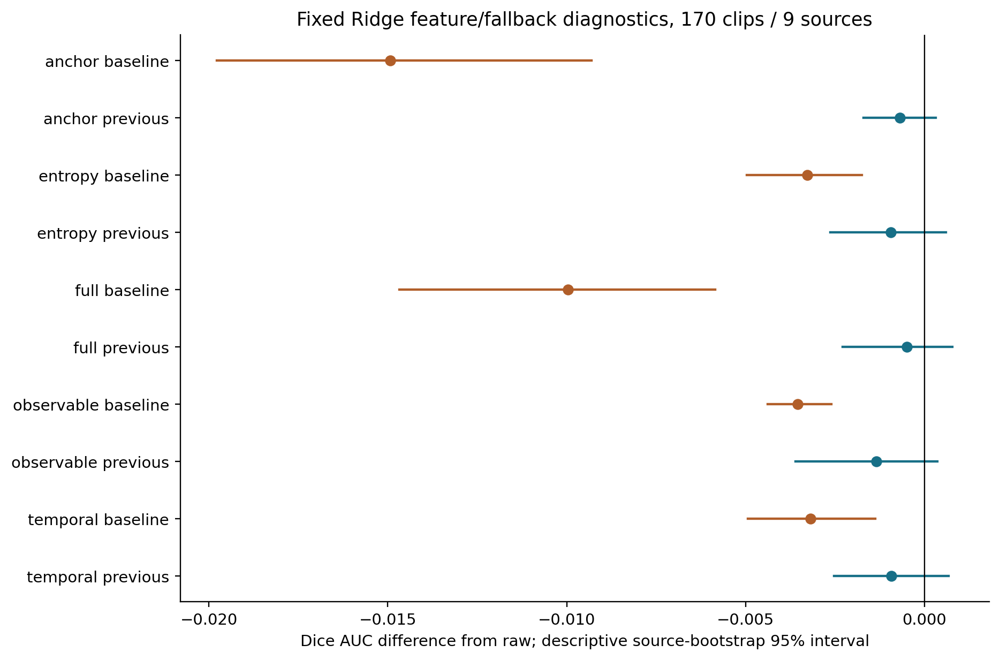
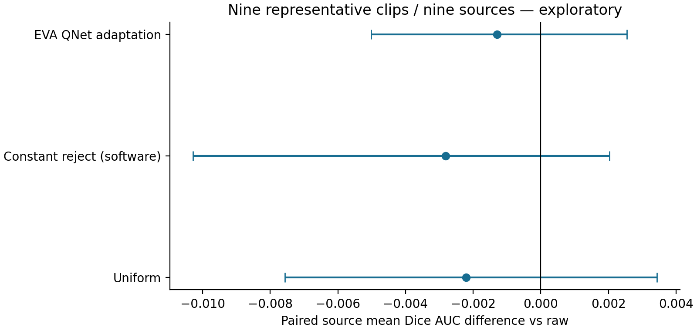
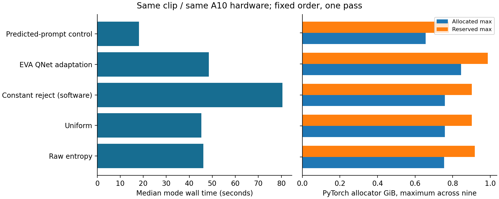

# Báo cáo khoa học bổ sung về correction trong video phẫu thuật phụ khoa

Nghiên cứu đã hoàn tất ablation trên 170 clip thuộc chín nguồn và đối chứng gần cùng benchmark compute trên chín clip đại diện. Mười ablation không cải thiện AUC trung bình của raw trên scoring pool gốc. EVA adaptation cũng chưa cho thấy lợi thế ở cohort đại diện; control tự động bằng prompt dự đoán làm giảm Dice trung bình. Những kết quả này giúp xác định giới hạn của verification và propagation trong phạm vi đã khảo sát, chưa chứng minh một phương pháp vượt trội.

Toàn bộ 161 bộ input bổ sung đã được chuyển riêng tư và kiểm SHA tại máy đích, gồm 20.447 file. Tuy nhiên, mở rộng inference lên toàn bộ 170 clip đã dừng theo điều kiện thời gian đăng ký trước. Lúc 19 giờ 37 phút ngày 21 tháng 10 năm 2026, thời gian còn lại đến hạn chỉ 3,48 giờ, trong khi dự toán compute mới là 8,28 worker giờ, tương đương 4,14 giờ với hai worker, cộng một giờ dự phòng. Không có inference mới trên 161 clip và không được dùng số bộ input đã tải thay cho số clip đã đánh giá.

Báo cáo này bổ sung cho báo cáo khoa học ngày 20 tháng 10, tập trung vào mười ablation, tác động của fallback, sensitivity theo scoring pool, các đối chứng gần và compute thực đo. Validation mới dừng ở protocol đã freeze; 57 clip validation chưa chạy và 73 clip final test vẫn khóa. Tất cả kết quả đều mang tính exploratory trên dữ liệu đã có lịch sử phát triển, không phải xác nhận lâm sàng hoặc bằng chứng novelty đã được xác lập.

## Ablation nhóm tín hiệu và phương án fallback

Cùng query trajectory raw, cùng labels, cùng source-balanced Ridge alpha10/threshold0 và LOSO. Mỗi fold chỉ fit trên tám nguồn khác, scaler fit trong training. Metadata target/ngân sách/thời gian có ở mọi nhóm; nhóm entropy thêm entropy/baseline entropy/ROI entropy, temporal thêm khoảng cách tới mask đã mua và temporal consistency, anchor thêm leave-one-prompt-out reconstruction và support flag. Observable loại toàn bộ anchor; full giữ toàn bộ. Không search family/threshold. Nhánh fallback giữ output trước hoặc quay về baseline khi reject. Quyết định tiếp theo dùng output đang giữ, nên hai fallback cũng thay đổi reference features về sau.

| pool | method | dice_auc | delta | lower95 | upper95 | positive_sources | sources |
| --- | --- | --- | --- | --- | --- | --- | --- |
| original | anchor_baseline | 0.878310 | -0.014926 | -0.019778 | -0.009299 | 1 | 9 |
| original | anchor_previous | 0.892551 | -0.000685 | -0.001706 | 0.000313 | 1 | 9 |
| original | entropy_baseline | 0.889969 | -0.003267 | -0.004971 | -0.001743 | 0 | 9 |
| original | entropy_previous | 0.892300 | -0.000936 | -0.002621 | 0.000612 | 1 | 9 |
| original | full_baseline | 0.883272 | -0.009964 | -0.014683 | -0.005849 | 1 | 9 |
| original | full_previous | 0.892743 | -0.000493 | -0.002278 | 0.000786 | 4 | 9 |
| original | observable_baseline | 0.889697 | -0.003539 | -0.004374 | -0.002594 | 0 | 9 |
| original | observable_previous | 0.891892 | -0.001344 | -0.003594 | 0.000373 | 4 | 9 |
| original | raw | 0.893236 | 0.000000 | 0.000000 | 0.000000 | 0 | 9 |
| original | temporal_baseline | 0.890057 | -0.003179 | -0.004938 | -0.001374 | 1 | 9 |
| original | temporal_previous | 0.892321 | -0.000915 | -0.002520 | 0.000680 | 3 | 9 |

Trong cấu hình đã định, cả mười biến thể có mean AUC thấp hơn raw. Giữ output trước tốt hơn quay về baseline ở từng nhóm tín hiệu xét theo source-macro mean. Kết quả này làm rõ rằng một cơ chế phát hiện cập nhật không tốt vẫn có thể gây mất chất lượng nếu hành động thay thế cũng yếu. Nó không chứng minh một nhóm feature không có thông tin ở mọi model, không xác định nguyên nhân nhân quả và không cho phép chọn lại biến thể thuận lợi rồi gọi là candidate đã xác nhận.

### So sánh trực tiếp hai fallback

| pool | group | previous_minus_baseline | lower95 | upper95 | positive_sources |
| --- | --- | --- | --- | --- | --- |
| original | entropy | 0.002331 | -0.000067 | 0.005180 | 7 |
| original | temporal | 0.002264 | 0.000342 | 0.004209 | 8 |
| original | anchor | 0.014241 | 0.008873 | 0.018980 | 8 |
| original | observable | 0.002195 | 0.000298 | 0.003915 | 7 |
| original | full | 0.009471 | 0.005524 | 0.014193 | 8 |

## Sensitivity temporal với scoring pool chung

Chấm thêm trên pool99/124 và pool124 cho mọi phương pháp, không loại frame khác nhau theo query được từng policy chọn. Query pool và ngân sách giữ nguyên. Mỗi contrast so với raw trong chính pool đó; tuyệt đối không chọn pool tốt nhất hoặc so endpoint tuyệt đối giữa các pool như một phép kiểm định tương đương. Kết quả ở frame cuối chỉ là một snapshot/target/clip, không phải tracking dày.

| pool | method | dice_auc | delta | lower95 | upper95 | positive_sources | sources |
| --- | --- | --- | --- | --- | --- | --- | --- |
| original | anchor_baseline | 0.878310 | -0.014926 | -0.019778 | -0.009299 | 1 | 9 |
| original | anchor_previous | 0.892551 | -0.000685 | -0.001706 | 0.000313 | 1 | 9 |
| original | entropy_baseline | 0.889969 | -0.003267 | -0.004971 | -0.001743 | 0 | 9 |
| original | entropy_previous | 0.892300 | -0.000936 | -0.002621 | 0.000612 | 1 | 9 |
| original | full_baseline | 0.883272 | -0.009964 | -0.014683 | -0.005849 | 1 | 9 |
| original | full_previous | 0.892743 | -0.000493 | -0.002278 | 0.000786 | 4 | 9 |
| original | observable_baseline | 0.889697 | -0.003539 | -0.004374 | -0.002594 | 0 | 9 |
| original | observable_previous | 0.891892 | -0.001344 | -0.003594 | 0.000373 | 4 | 9 |
| original | raw | 0.893236 | 0.000000 | 0.000000 | 0.000000 | 0 | 9 |
| original | temporal_baseline | 0.890057 | -0.003179 | -0.004938 | -0.001374 | 1 | 9 |
| original | temporal_previous | 0.892321 | -0.000915 | -0.002520 | 0.000680 | 3 | 9 |
| late_common | anchor_baseline | 0.871449 | -0.016061 | -0.022834 | -0.008845 | 1 | 9 |
| late_common | anchor_previous | 0.886939 | -0.000571 | -0.001954 | 0.000808 | 1 | 9 |
| late_common | entropy_baseline | 0.884569 | -0.002941 | -0.004737 | -0.001349 | 0 | 9 |
| late_common | entropy_previous | 0.887123 | -0.000387 | -0.002147 | 0.001376 | 1 | 9 |
| late_common | full_baseline | 0.878056 | -0.009454 | -0.016417 | -0.003913 | 1 | 9 |
| late_common | full_previous | 0.886971 | -0.000539 | -0.002739 | 0.001099 | 4 | 9 |
| late_common | observable_baseline | 0.884426 | -0.003084 | -0.004212 | -0.001940 | 0 | 9 |
| late_common | observable_previous | 0.886424 | -0.001086 | -0.003764 | 0.000702 | 3 | 9 |
| late_common | raw | 0.887510 | 0.000000 | 0.000000 | 0.000000 | 0 | 9 |
| late_common | temporal_baseline | 0.884481 | -0.003029 | -0.005215 | -0.000750 | 2 | 9 |
| late_common | temporal_previous | 0.887662 | 0.000152 | -0.000962 | 0.001405 | 4 | 9 |
| last_common | anchor_baseline | 0.862697 | -0.015954 | -0.025769 | -0.006066 | 1 | 9 |
| last_common | anchor_previous | 0.878648 | -0.000003 | -0.002343 | 0.003012 | 1 | 9 |
| last_common | entropy_baseline | 0.876738 | -0.001913 | -0.003249 | -0.000596 | 2 | 9 |
| last_common | entropy_previous | 0.878667 | 0.000016 | -0.002790 | 0.003303 | 2 | 9 |
| last_common | full_baseline | 0.867264 | -0.011387 | -0.022755 | -0.001779 | 1 | 9 |
| last_common | full_previous | 0.875983 | -0.002668 | -0.006248 | -0.000137 | 2 | 9 |
| last_common | observable_baseline | 0.875146 | -0.003505 | -0.006503 | -0.000370 | 1 | 9 |
| last_common | observable_previous | 0.875498 | -0.003153 | -0.006760 | -0.000345 | 2 | 9 |
| last_common | raw | 0.878651 | 0.000000 | 0.000000 | 0.000000 | 0 | 9 |
| last_common | temporal_baseline | 0.875727 | -0.002924 | -0.006478 | 0.001052 | 2 | 9 |
| last_common | temporal_previous | 0.878675 | 0.000024 | -0.003179 | 0.003513 | 3 | 9 |

CI là bootstrap mô tả trên chín nguồn, 2.000 resamples seed20261019; không coi 170 clip là 170 người bệnh độc lập. Nhiều comparison và lịch sử phát triển đã có không cho phép diễn giải confirmatory. Cảnh báo roundoff cột hằng của scaler được giữ trong log; mọi dự đoán và endpoint được kiểm hữu hạn, không đổi thuật toán để xóa cảnh báo. Raw AUC gốc tái dựng khớp1e-12.

## Protocol validation đã chuẩn bị

57 clip171–227 thuộc video nguồn11/13/16 với số clip19/21/17. Protocol-only, không có dispatcher hoặc inference. Định nghĩa raw-minus-uniform primary contrast cho một đánh giá mô tả fixed controls; random là secondary, sourcebootstrap và sensitivity giữ thống nhất. Chỉ ba nguồn nên bất định lớn; historical exposure không biến mất khi gọi tên validation. Hai candidate cũ và các ablation hậu kiểm không được tự promote. Finaltest73clip tiếp tục khóa. Tài liệu: protocols/20261020_completion_validation_v1/PROTOCOL.md và COHORT_AND_ELIGIBILITY.json.

## Phạm vi bằng chứng

Đã hoàn tất chín clip nhỏ nhất theo ID trong chín nguồn huấn luyện: 001, 038, 059, 086, 105, 116, 138, 146 và 160. Việc chọn clip không dựa trên hiệu quả phương pháp. Mỗi clip chạy năm cấu hình theo thứ tự cố định trên cùng GPU NVIDIA A10, cùng dữ liệu, checkpoint SAM2 và precision. Đây là cohort thăm dò gồm một clip mỗi nguồn, chưa đại diện đầy đủ 170 clip và không phải validation. Tất cả chín clip qua kiểm tra checksum, ngân sách, query history và raw replay parity; chênh lệch metric raw tối đa khoảng 0,000158, trong ngưỡng đã định.

EVA dùng QNet chính thức được strict-load để chọn query bằng khoảng cách embedding, thích nghi với mask-only và SAM2. Đây không phải tái lập đầy đủ hệ thống EVA RL/MiVOS; QNet bổ sung supervision tiền huấn luyện và lịch sử exposure riêng. Control lấy cảm hứng SASVi dùng mask do baseline dự đoán, reset theo đoạn 25 frame và kiểm tra foreground bền bốn frame, không sử dụng gold mask. Khác biệt semantic union, prompt và lookahead được giữ rõ; không gọi là tái lập SASVi gốc.

## Hiệu quả với ngân sách năm mask được tính đầy đủ

AUC Dice chuẩn hóa dùng trọng số 0,1 / 0,2 / 0,4 / 0,3 tại ngân sách 0 / 1 / 2 / 5 mask. Mỗi mask khởi tạo cũng được tính vào ngân sách. CI mô tả lấy bootstrap 2.000 lần trên chín nguồn, seed 20261019. Không có phép kiểm định xác nhận hoặc promotion ứng viên từ kết quả này.

| mode | dice_auc | delta_vs_contemporaneous_raw | lower95 | upper95 | positive_sources |
| --- | --- | --- | --- | --- | --- |
| raw | 0.916574 | 0.000000 | 0.000000 | 0.000000 | 0 |
| uniform | 0.914371 | -0.002203 | -0.007562 | 0.003435 | 3 |
| constant_reject_software | 0.913765 | -0.002808 | -0.010285 | 0.002029 | 3 |
| eva_qnet_mask_adaptation | 0.915285 | -0.001289 | -0.005017 | 0.002541 | 3 |

EVA adaptation có AUC trung bình thấp hơn raw khoảng 0,00129; chỉ ba trong chín nguồn có chênh lệch dương và CI bao gồm 0. Uniform và constant-reject cũng có trung bình thấp hơn raw. Dữ liệu hiện tại không ủng hộ kết luận EVA adaptation cải thiện hiệu quả ngân sách; cũng chưa đủ để khẳng định tương đương hoặc suy rộng cho hệ thống gốc. Constant-reject là đối chứng phần mềm cho chi phí fallback, không phải mô hình gate đã học. Nó giữ nguyên query raw nhưng cần thêm propagation để tái tạo đầu ra được giữ.

### Tất cả nguồn, không loại nguồn bất lợi

| procedure_id | constant_reject_software | eva_qnet_mask_adaptation | raw | uniform | EVA_minus_raw |
| --- | --- | --- | --- | --- | --- |
| AutoLaparo_video_01 | 0.951514 | 0.953384 | 0.953056 | 0.947487 | 0.000328 |
| AutoLaparo_video_02 | 0.863245 | 0.857230 | 0.858879 | 0.842887 | -0.001649 |
| AutoLaparo_video_03 | 0.921450 | 0.939896 | 0.951514 | 0.967418 | -0.011618 |
| AutoLaparo_video_04 | 0.918910 | 0.911773 | 0.921062 | 0.910168 | -0.009289 |
| AutoLaparo_video_05 | 0.953361 | 0.953037 | 0.953160 | 0.953271 | -0.000123 |
| AutoLaparo_video_06 | 0.971832 | 0.972374 | 0.973113 | 0.970758 | -0.000738 |
| AutoLaparo_video_07 | 0.936432 | 0.936651 | 0.936651 | 0.935419 | 0.000000 |
| AutoLaparo_video_08 | 0.889749 | 0.895460 | 0.884185 | 0.885404 | 0.011275 |
| AutoLaparo_video_10 | 0.817396 | 0.817761 | 0.817544 | 0.816523 | 0.000217 |

## Control tự động: endpoint không dùng gold mask

Control này không có đường cong gold-budget AUC. Chỉ so endpoint Dice của nó với baseline framewise ở ngân sách 0 trong chính scoring pool tương ứng. Số prompt dự đoán và số propagation được báo riêng.

| pool | dice | baseline_dice | delta | lower95 | upper95 | positive_sources |
| --- | --- | --- | --- | --- | --- | --- |
| original | 0.811182 | 0.849355 | -0.038172 | -0.092958 | -0.000635 | 4 |
| late_common | 0.808498 | 0.860217 | -0.051719 | -0.112476 | -0.006775 | 4 |
| last_common | 0.799350 | 0.896010 | -0.096660 | -0.223568 | 0.000174 | 4 |

Ở pool gốc, Dice trung bình giảm khoảng 0,03817, với bốn trên chín nguồn có chênh lệch dương. Hiện tượng này phù hợp với khả năng propagation mang lỗi prompt dự đoán sang frame khác, nhưng thí nghiệm chưa cô lập nguyên nhân. Không thể từ kết quả này kết luận về toàn bộ SASVi hoặc khả năng dùng lâm sàng. Giữ kết quả âm thay vì thay gold vào prompt hoặc điều chỉnh reset để cải thiện trên cohort đã xem.

## Compute và bộ nhớ thực đo

| mode | seconds_median | seconds_min | seconds_max | allocated_GiB_max | reserved_GiB_max |
| --- | --- | --- | --- | --- | --- |
| constant_reject_software | 80.514743 | 77.357908 | 86.621898 | 0.758186 | 0.902344 |
| eva_qnet_mask_adaptation | 48.509189 | 44.298375 | 49.734579 | 0.844459 | 0.986328 |
| raw | 46.056659 | 43.364007 | 49.342467 | 0.754619 | 0.917969 |
| sasvi_predicted_adaptation | 18.147990 | 15.540264 | 19.193846 | 0.656446 | 0.779297 |
| uniform | 45.194147 | 41.312215 | 48.656800 | 0.758186 | 0.902344 |

Thời gian bao gồm khởi tạo engine và QNet nếu có, đồng bộ CUDA; chuẩn bị JPEG/baseline đã thực hiện từ trước và không được tính. Đây là một lượt chạy, thứ tự cố định, không phải benchmark latency ngẫu nhiên hóa. Raw trung vị khoảng 46,06 giây, EVA 48,51 giây, constant-reject 80,51 giây, control dự đoán 18,15 giây. Control dự đoán xử lý các đoạn ngắn với 0 gold mask, nên không suy ra lợi thế tốc độ ở cùng nhiệm vụ hoặc cùng chất lượng với năm paid mask. Không quy đổi callback đọc gold thành thời gian bác sĩ.

Bộ nhớ allocated/reserved là phạm vi allocator PyTorch, không phải tổng VRAM từ nvidia-smi. Host RSS đầu/cuối được lưu riêng; host high-water là cực đại cộng dồn của cả process, không phải peak riêng mỗi phương pháp. Median số propagation raw/EVA là 5, constant-reject là 9; control dự đoán có median 10 predicted prompts và 10 propagation, 0 gold mask.

## Sensitivity với scoring pool chung

Mọi phương pháp dùng cùng pool trong từng phân tích; query pool giữ nguyên. Không chọn pool có lợi nhất và không so endpoint tuyệt đối giữa các pool như phép kiểm định tương đương.

| pool | mode | dice_auc | delta_vs_contemporaneous_raw | lower95 | upper95 |
| --- | --- | --- | --- | --- | --- |
| original | raw | 0.916574 | 0.000000 | 0.000000 | 0.000000 |
| original | uniform | 0.914371 | -0.002203 | -0.007562 | 0.003435 |
| original | constant_reject_software | 0.913765 | -0.002808 | -0.010285 | 0.002029 |
| original | eva_qnet_mask_adaptation | 0.915285 | -0.001289 | -0.005017 | 0.002541 |
| late_common | raw | 0.906441 | 0.000000 | 0.000000 | 0.000000 |
| late_common | uniform | 0.903295 | -0.003147 | -0.009881 | 0.003465 |
| late_common | constant_reject_software | 0.904904 | -0.001538 | -0.010617 | 0.005554 |
| late_common | eva_qnet_mask_adaptation | 0.904146 | -0.002295 | -0.007866 | 0.004104 |
| last_common | raw | 0.886947 | 0.000000 | 0.000000 | 0.000000 |
| last_common | uniform | 0.881481 | -0.005466 | -0.018310 | 0.005130 |
| last_common | constant_reject_software | 0.886408 | -0.000539 | -0.011554 | 0.009145 |
| last_common | eva_qnet_mask_adaptation | 0.882716 | -0.004231 | -0.016908 | 0.006988 |

## Kết luận và phạm vi còn thiếu

Cơ chế fallback ảnh hưởng rõ đến endpoint: giữ output trước có trung bình tốt hơn quay về baseline ở cả năm nhóm tín hiệu. Điều này không chứng minh feature anchor tạo lợi ích; toàn bộ mười tổ hợp vẫn thấp hơn raw trên pool gốc. Kết quả yêu cầu phân biệt giá trị của tín hiệu kiểm soát với giá trị của quy tắc bảo toàn đầu ra. Chi phí constant-reject tăng từ khoảng 46 giây lên 81 giây vì số propagation tăng từ năm lên chín, nên tính toán gate không chỉ là chi phí suy luận một bộ phân loại nhỏ.

EVA adaptation dùng QNet tiền huấn luyện chính thức nhưng chưa vượt raw trong chín đại diện. Control tự động dùng zero gold mask nên đánh giá bằng endpoint riêng; sự suy giảm Dice cho thấy prompt dự đoán có thể dẫn tới propagation không có lợi trong scope này. Không thể suy rộng kết luận sang nguyên bản EVA hoặc SASVi do khác bộ propagator, supervision, annotation unit và reset semantics.

Phần hoàn tất gồm ablation170, benchmark9, kiểm tra parity9, chuẩn bị protocol validation, và chuyển đủ input161. Phần chưa hoàn tất gồm inference đối chứng trên161 clip bổ sung và kết quả validation/final test. Gate thời gian được giữ nguyên, không thay dự toán sau khi đã biết kết quả để ép chạy. Dữ liệu và checkpoint nguyên gốc được bảo toàn. Không đo thời gian chuyên gia, không có clinical review mới, không xác nhận tính đầy đủ giải phẫu của nhãn phát hành.

Đánh giá đầy đủ cần một lịch compute riêng và protocol được giữ nguyên hoặc amendment đăng ký trước. Các candidate learned cũ vẫn không đạt promotion; ablation hậu kiểm không thay thế điều kiện đó.
