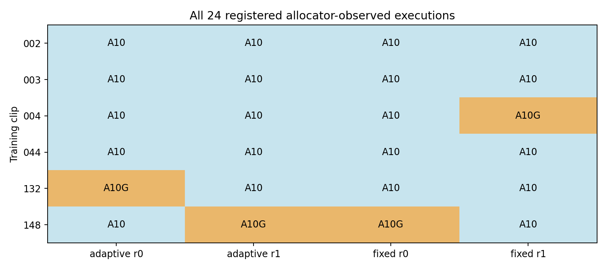
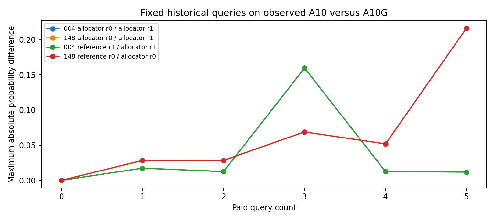
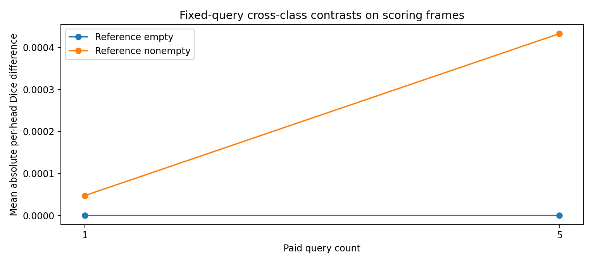
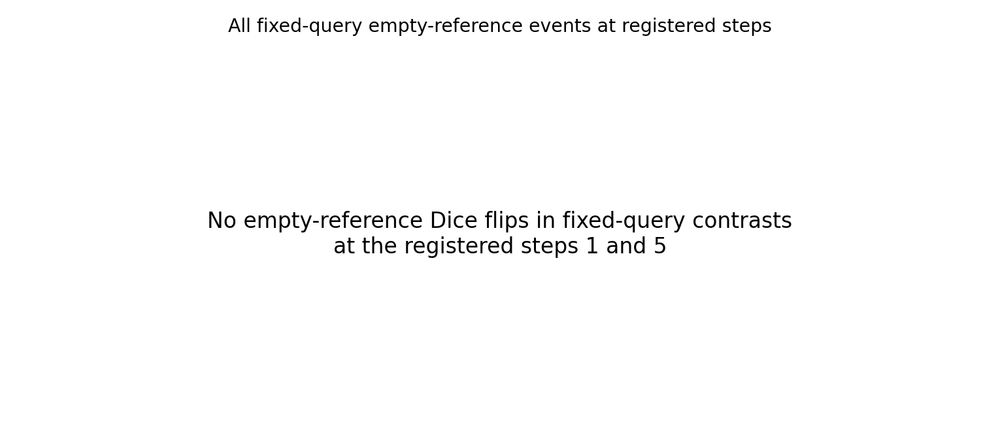

# Kiểm tra tái lập propagation giữa các môi trường GPU trong GynSurg

## Kết luận và phạm vi

Đã hoàn thành toàn bộ 24 lượt của thiết kế bổ sung, gồm 20 lượt A10 và 4 lượt A10G. Audit độc lập đạt trên 43 execution records gồm 19 lượt tham chiếu và 24 lượt mới, 516 cặp bước và phạm vi, 1548 điểm Dice theo head và frame, cùng 684 đối chiếu head. Đây là panel kỹ thuật sáu clip training đã được xem trước, thuộc bốn video nguồn; các cell và cặp bước không phải bệnh nhân độc lập và không tạo cỡ mẫu suy luận lâm sàng.

Trong 192 cặp bước scoring có cùng tên loại GPU, 192 cặp khớp số học chính xác. Khi giữ nguyên lịch sử query, các cặp A10 so với A10G vẫn có sai khác xác suất lớn nhất 0.216308594 và tỷ lệ pixel vượt ngưỡng 0,5 khác nhau lớn nhất 0.000251486. Quan sát này cho thấy thay đổi query routing không đủ giải thích mọi sai khác. Nó không tách riêng ảnh hưởng GPU khỏi kernel, driver, host hoặc các khác biệt môi trường đi kèm.

## Thiết kế và coverage

Mỗi clip có adaptive và fixed historical queries, mỗi chế độ hai lượt fresh process. Thứ tự 24 lượt được cố định trước khi đọc kết quả định lượng. Chấp nhận mọi A10 hoặc A10G do allocator mặc định cấp; không chọn lại hardware, không nới tolerance, không đổi precision hoặc threshold, không fit mô hình. Chế độ fixed dùng lịch sử query training đã đăng ký; scoring reference chỉ tham gia đánh giá sau inference. Nghiên cứu bổ sung được đăng ký sau khi đã biết lỗi lịch sử, không phải xác nhận độc lập.

|gpu|mode|cells|
|---|---|---|
|A10|adaptive|10|
|A10|fixed|10|
|A10G|adaptive|2|
|A10G|fixed|2|

## Đối chiếu toàn bộ factor

|factor|step_pairs|exact|max_probability_delta|max_mask_flip_fraction|
|---|---|---|---|---|
|additional_repeat|96|96|0.000000000|0.000000000|
|mode|48|48|0.000000000|0.000000000|
|mode_mixed_hardware|24|4|1.000000000|0.009318701|
|observed_hardware_environment|18|3|1.000000000|0.009318701|
|repeat|48|48|0.000000000|0.000000000|
|repeat_mixed_hardware|24|4|1.000000000|0.009318701|

Mỗi hàng đếm cặp bước scoring, không phải lượt chạy hay video độc lập. Factor mode khác với cross-class fixed-query contrast; các cặp khác hardware được ghi riêng, không gộp thành hiệu ứng nhân quả của chế độ. Tại budget 0, audit xác nhận baseline bitwise equality trong toàn bộ cặp khả dụng.

## Giữ cố định query để phân biệt routing và propagation

|clip_id|mode_a|mode_b|first_state_difference|first_query_prefix_difference|max_probability_delta|
|---|---|---|---|---|---|
|004|adaptive|fixed|1|-1|0.159545898|
|004|fixed|fixed|1|-1|0.159545898|
|132|adaptive|adaptive|1|4|1.000000000|
|132|adaptive|fixed|1|4|1.000000000|
|148|adaptive|adaptive|1|2|0.999249935|
|148|adaptive|fixed|1|-1|0.216308594|
|148|adaptive|fixed|1|2|0.999249935|
|148|fixed|fixed|1|-1|0.216308594|
|004|fixed|fixed|1|-1|0.159545898|
|132|adaptive|adaptive|1|4|1.000000000|
|148|fixed|fixed|1|-1|0.216308594|

Bước sai khác query prefix đầu tiên là -1 khi không có sai khác trong sáu trạng thái đã lưu. State difference được tính trên scoring frames. Với fixed queries, một sai khác state dưới cùng query prefix là bằng chứng trực tiếp rằng routing không phải lời giải thích duy nhất; chưa xác định thao tác tính toán bên trong nào tạo sai khác. Sáu snapshot theo query budget không cung cấp trace của mọi frame nội bộ.

## Phân rã Dice theo reference rỗng và không rỗng

|step|reference_present|head_pairs|mean_absolute_dice_difference|maximum_absolute_dice_difference|
|---|---|---|---|---|
|1|False|6|0.000000000|0.000000000|
|1|True|18|0.000047492|0.000240745|
|5|False|6|0.000000000|0.000000000|
|5|True|18|0.000432736|0.001133512|

Ở hai bước đã đăng ký 1 và 5 của fixed-query contrasts, có 0 sự kiện thay đổi Dice trên reference rỗng. Trong toàn bộ đối chiếu cross-origin matched gồm adaptive, có 3 sự kiện như vậy. Cụ thể clip 132 adaptive tại frame 99 head 0 ở budgets 1, 2 và 3 có prediction từ 0 thành 925 pixel, khiến quy ước Dice empty-empty bằng 1 chuyển thành 0. Ở các bước đó query prefix vẫn giống nhau. Sự kiện này góp phần giải thích cách metric tổng hợp có thể thay đổi mạnh; không chứng minh mọi lỗi historical có cùng cơ chế. Reference rỗng là mask phát hành rỗng, không đồng nghĩa cấu trúc giải phẫu vắng mặt trên lâm sàng. Không thay threshold hoặc định nghĩa metric sau khi đọc kết quả.

## Đối chiếu ngưỡng lịch sử

|clip_id|gpu|repeat|same_query|max_metric_delta|auc_delta_bound|passed|
|---|---|---|---|---|---|---|
|002|A10|0|True|0.000000000|0.000000000|True|
|002|A10|1|True|0.000000000|0.000000000|True|
|003|A10|0|True|0.000000000|0.000000000|True|
|003|A10|1|True|0.000000000|0.000000000|True|
|004|A10|0|True|0.000000000|0.000000000|True|
|004|A10|1|True|0.000000000|0.000000000|True|
|044|A10|0|True|0.000000000|0.000000000|True|
|044|A10|1|True|0.000000000|0.000000000|True|
|132|A10G|0|False|0.229002895|0.137751031|False|
|132|A10|1|True|0.000000000|0.000000000|True|
|148|A10|0|True|0.000000000|0.000000000|True|
|148|A10G|1|False|0.146242240|0.058678299|False|

Đây là diagnostic mới trên panel chọn có chủ đích. Các lượt đạt hoặc không đạt không thay thế 170 outputs lịch sử; gate gốc vẫn thất bại 20 trong 170 clip. Không loại các failures, không công bố lại cohort như primary accepted và không mở validation hoặc final test.

## Compute và giới hạn

|measure|value|
|---|---|
|New measured worker GPU hours|0.351523422|
|Cumulative conservative planning hours|23.514314785|
|GPU planning cap|24.000000000|

Worker GPU hours là thời gian đo của hàm worker; conservative planning cộng startup và reserves theo protocol, không phải hóa đơn hoặc chi phí thực trả. Thiết kế 24 cell bổ sung hoàn thành, nhưng không biến thiết kế 48 cell V2 thành đầy đủ: V2 có 19 lượt A10 inference, 6 lượt không inference do expected-type guard, và 23 cell không dispatch. V2 thực tế từng được cấp 5 A10G nhưng guard từ chối; không được mô tả A10G là hoàn toàn không có sẵn. V3 cloud pin thất bại trước FunctionCall và không tạo inference.

## Hàm ý cho bài báo

Kết quả phù hợp cho phần computational reproducibility và failure analysis: đặt fixed-query control để kiểm tra propagation, báo cả xác suất liên tục và mask threshold, và phân rã metric theo reference presence. Chưa có bằng chứng cải thiện efficacy của phương pháp mới hoặc xác lập novelty. Các đối chứng phương pháp trên 170 clip vẫn negative hoặc inconclusive theo báo cáo trước. Cần protocol riêng và điều kiện đủ trước validation 57 clip hoặc final test 73 clip; cả hai vẫn đóng. Không có review lâm sàng mới, dữ liệu thời gian bác sĩ hoặc kết luận an toàn. Việc đạt kiểm tra tính toàn vẹn kỹ thuật không đồng nghĩa bài sẵn sàng nộp.
