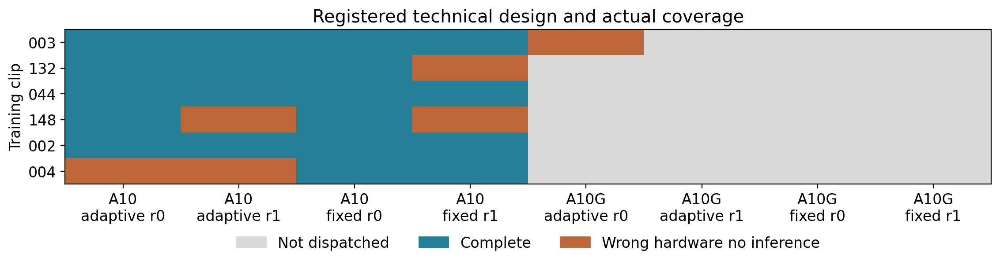
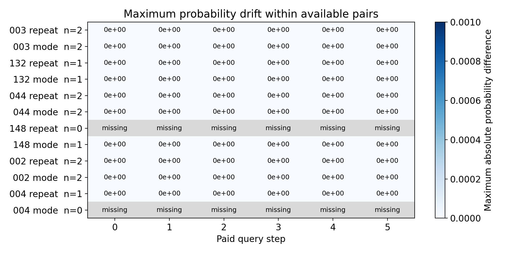

# Kiểm tra tái lập correction trên video phẫu thuật phụ khoa

## Phạm vi và kết luận chính

Nghiên cứu kỹ thuật này tiếp nối phát hiện historical parity thất bại ở 20 trong 170 clip development. Đã đăng ký 48 cell trên sáu clip để tách query routing khỏi propagation, với hai chế độ adaptive và fixed historical query, hai lần lặp fresh process và hai tên hardware dự kiến. Cell là một lượt thực thi kỹ thuật, không phải bệnh nhân hoặc video nguồn độc lập.

Kết quả hiện tại có 19 cell hoàn thành trong 25 lượt đã gửi; 6 lượt nhận sai hardware và không thực hiện inference; 23 cell không dispatch. Hardware thực sự có kết quả là NVIDIA A10. Thiết kế đầy đủ 48 cell chưa hoàn thành. Các so sánh khả dụng khớp từng phần tử xác suất. Điều này không sửa gate gốc và không xác lập nguyên nhân của 20 failures lịch sử.

## Thiết kế và thực thi

Sáu clip cố định là 003, 132, 044, 148, 002 và 004, thuộc bốn video nguồn development đã từng khảo sát. Panel chọn theo loại lỗi và ID trước lượt inference mới; kết quả development trước đó đã được biết, do đó đây là diagnostic posthoc. Adaptive dùng selector raw gốc; fixed replay mua đúng năm mask theo lịch sử training. Mỗi correction vẫn tính ngân sách. Observer chỉ ghi prediction, không nhận scoring gold. Snapshot private ghi tại sáu frame query/scoring sau từng bước 0 đến 5; query/scoring pool không đổi. Các so sánh lặp thuộc cùng hardware class nhưng có thể khác thiết bị vật lý; bảng physical_pair_scope chỉ báo cùng hay khác thiết bị, không công bố UUID.

Hai allocation preflight quyết định hardware family khả dụng trước scale. Lượt không khớp expected hardware được lưu là skip, không retry để chọn GPU thuận lợi. Thiếu pair không được đổi thành zero difference. Pilot được chấp nhận theo cấu trúc logging và budget, không dùng efficacy hoặc parity để quyết định mở rộng. Original worker, selector, SAM2 engine, threshold và gate không sửa.

## Coverage thực tế

|expected_gpu|mode|status|cells|
|---|---|---|---|
|NVIDIA A10|adaptive|complete|9|
|NVIDIA A10|adaptive|hardware_mismatch_no_inference|3|
|NVIDIA A10|fixed|complete|10|
|NVIDIA A10|fixed|hardware_mismatch_no_inference|2|
|NVIDIA A10G|adaptive|hardware_mismatch_no_inference|1|
|NVIDIA A10G|adaptive|not_dispatched_hardware_unavailable|11|
|NVIDIA A10G|fixed|not_dispatched_hardware_unavailable|12|

## So sánh xác suất theo từng bước

|clip_id|factor|step_pairs|exact_step_pairs|max_probability_difference|max_mask_flip_fraction|
|---|---|---|---|---|---|
|002|mode|12|12|0.000000000|0.000000000|
|002|repeat|12|12|0.000000000|0.000000000|
|003|mode|12|12|0.000000000|0.000000000|
|003|repeat|12|12|0.000000000|0.000000000|
|004|repeat|6|6|0.000000000|0.000000000|
|044|mode|12|12|0.000000000|0.000000000|
|044|repeat|12|12|0.000000000|0.000000000|
|132|mode|6|6|0.000000000|0.000000000|
|132|repeat|6|6|0.000000000|0.000000000|
|148|mode|6|6|0.000000000|0.000000000|

Có 96 step pairs được đối chiếu độc lập với SHA snapshot, query prefix và coverage. Maximum probability difference là 0.0; maximum fraction thay đổi mask tại threshold 0.5 là 0.0. Đây là so sánh trên các frame đã lưu, không phải mọi tensor trung gian hoặc mọi frame video. Không có dữ liệu cho pair còn thiếu, không có CI hiệu quả hoặc phân tích superiority từ panel kỹ thuật này.

## Đối chiếu lịch sử trên panel đã đăng ký

|clip_id|records|query_matches|maximum_metric_difference|maximum_auc_bound|tolerance_passes|
|---|---|---|---|---|---|
|002|2|2|0.000000000|0.000000000|2|
|003|2|2|0.000000000|0.000000000|2|
|044|2|2|0.000000000|0.000000000|2|
|132|2|2|0.000000000|0.000000000|2|
|148|1|1|0.000000000|0.000000000|1|

Trong 9 lượt adaptive của panel, 9 lượt đáp ứng lại ngưỡng lịch sử. Đây là diagnostic mới trên panel cố định, không được thay thế các outputs lịch sử, bỏ 20 failures hoặc đổi phân tích toàn cohort thành primary accepted. Chỉ có thể nói kết quả trong phạm vi actual hardware và cell thực sự hoàn thành.

## Phát hiện từ audit trước và giới hạn còn lại

Audit CPU trước đó xác nhận 17 trong 20 failures vẫn có toàn bộ query history giống nhau; 044 và 132 lệch metric từ budget 1 trước query divergence. Baseline budget 0 metric khớp đến 2.22e-16, chưa chứng minh tensor bitwise equality lịch sử. Margin entropy lịch sử tại divergence không phải margin current state. Vì historical run không lưu tensor từng bước nên không thể tái dựng đầy đủ chuỗi sai lệch từ các CSV cũ.

Không có cơ sở kết luận hardware là nguyên nhân duy nhất, mô hình đã được sửa, hoặc deterministic algorithms bảo đảm toàn bộ pipeline. Actual device, driver và các precision flags được lưu riêng để audit; không thay precision hoặc nới tolerance trong lượt này. Validation 57 clip chưa chạy, final test 73 clip vẫn khóa; chưa có candidate được promote, clinical review hoặc dữ liệu thời gian bác sĩ mới.

## Phần bổ sung chưa thực hiện được

Một protocol kỹ thuật riêng đã chuẩn bị để yêu cầu cloud AWS bên trong Modal nhằm tiếp cận hardware A10G còn thiếu. Dịch vụ từ chối ở bước tạo function với thông báo “Pinning cloud aws not supported”. Receipt không có scientific call nào, không có inference của nhánh này và không có dữ liệu cross environment mới. Các cell thiếu của đợt đầu giữ nguyên. Không đổi gói, tăng limit hoặc chạy allocation lặp lại để tìm kết quả thuận lợi. Chưa thể kết luận nguyên nhân khác biệt A10 và A10G từ kết quả đang có.

## Compute và hệ quả đối với paper

Tổng measured worker time của các lượt mới là 0.287821 giờ; cumulative conservative planning có startup và failure reserve là 22.762791 GPU giờ so với cap 24. Không coi các số này là billing hoặc credit còn lại. Không tăng giới hạn tài khoản.

Paper nên giữ định vị empirical audit, trình bày kết quả âm và reproducibility limitation. Nghiên cứu hiện tại làm rõ độ lặp lại có điều kiện trong phạm vi quan sát; phần thiếu hardware không được mô tả là đã kiểm chứng. Muốn xác lập tác động hardware hoặc precision cần protocol mới và phân bổ thiết bị thực sự phù hợp, không thực hiện các lượt chọn lọc để cứu hiệu quả. Tác giả và ethics vẫn cần xác nhận trước công bố.
