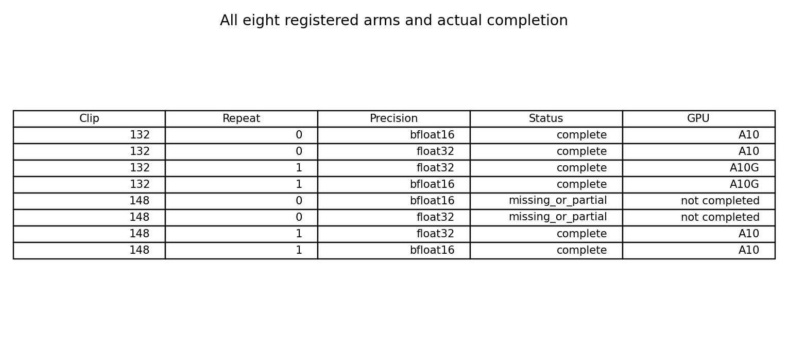
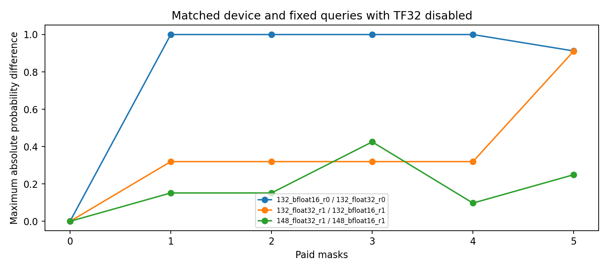
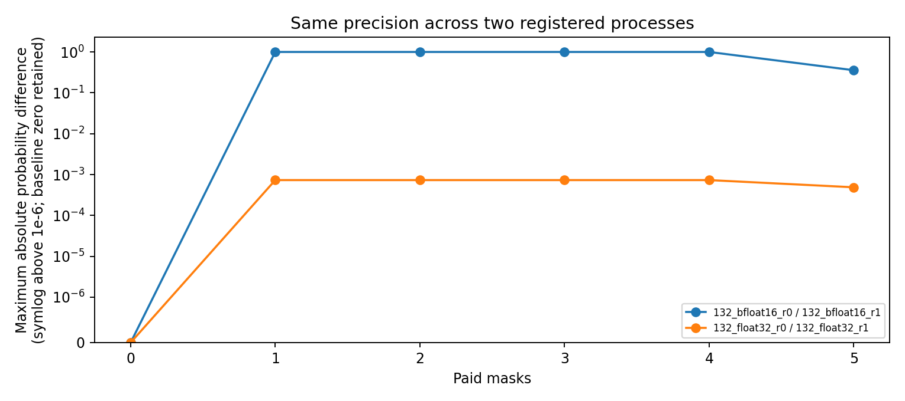
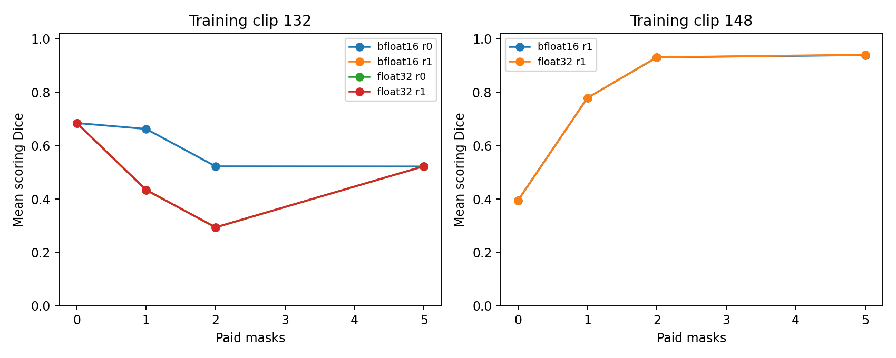

# Chẩn đoán precision và runtime cho propagation GynSurg

## Phạm vi và kết luận có thể rút ra

Hoàn thành 6 trong 8 arm đã đăng ký, qua 4 paired GPU calls. Mỗi paired call chạy tuần tự BF16 và FP32 bằng hai engine mới trên cùng thiết bị vật lý; repeat 0 chạy BF16 trước, repeat 1 chạy FP32 trước. Tất cả đều giữ fixed historical queries, seed 20261017, checkpoint và dữ liệu giống nhau. Hai cờ TF32 đều tắt sau khi dựng engine và được giữ tắt khi correction. Vì vậy đây là can thiệp precision của autocast dưới runtime TF32-off chung, không phải tái chạy phiên bản cũ để thay lỗi. Nhãn FP32 ở đây nghĩa là tắt external BF16 autocast; upstream SAM2 vẫn chủ động lưu mask-memory features ở BF16 tại hai vị trí đã audit. Đây không phải pipeline mọi tensor đều FP32. Chính sách lưu memory nội bộ đó được giữ giống nhau ở hai arm và không sửa upstream code.

Thiết kế hiện chưa hoàn thành: paired call 148 repeat 0 dừng tại chốt không ghi đè do thư mục 148_bfloat16_r0 đã tồn tại; nguyên nhân tạo trạng thái đó chưa xác định. Hai arm của call này không có kết quả hoàn chỉnh. Giữ nguyên exception, trace và disposition; không gửi call GPU thứ năm và không gọi đây là negative efficacy. Audit kỹ thuật đạt chỉ áp dụng cho sáu arm đã hoàn thành, không biến thiết kế tám arm thành đầy đủ.

Trên 18 cặp bước scoring trong cùng thiết bị, sai khác xác suất lớn nhất giữa precision là 1.0. Trên 12 cặp bước scoring giữa hai process có cùng precision, 2 cặp khớp số học chính xác. Cần đọc cùng actual hardware, thứ tự engine và bảng Dice; không được suy rằng FP32 chính xác hơn hoặc đã sửa mọi sai khác chỉ vì một nhóm có ít drift hơn.

## Coverage và thứ tự thực thi

|clip_id|repeat|precision|status|gpu|
|---|---|---|---|---|
|132|0|bfloat16|complete|A10|
|132|0|float32|complete|A10|
|132|1|float32|complete|A10G|
|132|1|bfloat16|complete|A10G|
|148|0|bfloat16|missing_or_partial|not completed|
|148|0|float32|missing_or_partial|not completed|
|148|1|float32|complete|A10|
|148|1|bfloat16|complete|A10|

|clip_id|repeat|first_precision|completed_arms|same_physical_device|
|---|---|---|---|---|
|132|0|bfloat16|2|True|
|132|1|float32|2|True|
|148|0|bfloat16|0|not_verified_incomplete|
|148|1|float32|2|True|

Đây là hai clip training 132 và 148 được chọn sau khi đã biết lỗi, không phải dữ liệu xác nhận độc lập. Tám arm hoặc nhiều cặp bước không phải tám bệnh nhân. Không tìm hardware thuận lợi, không thử seed khác, không dùng hiệu quả làm điều kiện chạy tiếp. Các cell thiếu hoặc timeout vẫn nằm trong disposition.

## So sánh precision khi giữ nguyên thiết bị

|factor|precision_a|precision_b|gpu_a|gpu_b|step_pairs|exact_steps|max_probability_difference|max_flip_fraction|
|---|---|---|---|---|---|---|---|---|
|same_precision_repeat|bfloat16|bfloat16|NVIDIA A10|NVIDIA A10G|6|1|1.000000000|0.009441587|
|same_precision_repeat|float32|float32|NVIDIA A10|NVIDIA A10G|6|1|0.000732422|0.000001715|
|within_device_precision|bfloat16|float32|NVIDIA A10|NVIDIA A10|6|1|1.000000000|0.009625057|
|within_device_precision|float32|bfloat16|NVIDIA A10|NVIDIA A10|6|1|0.425292969|0.000340078|
|within_device_precision|float32|bfloat16|NVIDIA A10G|NVIDIA A10G|6|1|0.911178589|0.001719250|

Hai precision khác autocast; cả hai dùng TF32-off. Phần code và các backend flags còn lại được kiểm tra giống nhau trong mỗi paired process. Tái tạo fresh engine và đảo thứ tự giúp kiểm soát ảnh hưởng thứ tự, nhưng hai lượt lặp trên hai clip không đủ loại mọi ảnh hưởng cache hoặc xác lập ổn định trên mọi môi trường.

## Tái lập giữa các process có cùng precision

Phải tách các cặp cùng tên GPU class khỏi các cặp khác class nếu allocator cấp khác nhau. Trường hợp không có cả A10 và A10G trong nhóm FP32 thì không có cơ sở kết luận FP32 sửa được cross-class drift. Không đồng nhất class GPU với cùng thiết bị vật lý.

Trên riêng clip 132, cặp repeat A10 so với A10G có max probability drift 1.000000000 ở BF16 và 0.000732422 khi tắt BF16 autocast. Tỷ lệ mask flips lớn nhất lần lượt là 0.009441587 và 0.000001715. Nhánh float32 vẫn không bitwise identical. Đây là một clip, một cặp repeat cho mỗi precision; hardware và thứ tự precision của repeat đi cùng nhau trong thiết kế nhỏ này. Không được suy thành mức giảm drift chung trên cohort hoặc GPU causality thuần.

## Dice và quy ước reference rỗng

|step|reference_present|head_pairs|mean_abs_delta_dice|max_abs_delta_dice|
|---|---|---|---|---|
|0|False|4|0.000000000|0.000000000|
|0|True|14|0.000000000|0.000000000|
|1|False|4|0.250000000|1.000000000|
|1|True|14|0.026930874|0.370165805|
|2|False|4|0.250000000|1.000000000|
|2|True|14|0.027426440|0.370165805|
|3|False|4|0.250000000|1.000000000|
|3|True|14|0.027432226|0.370165805|
|4|False|4|0.250000000|1.000000000|
|4|True|14|0.027422037|0.370165805|
|5|False|4|0.000000000|0.000000000|
|5|True|14|0.001380629|0.005037840|

Có 4 sự kiện delta Dice khác 0 trên reference rỗng trong các đối chiếu precision đã đăng ký. Per-head/per-frame outputs và prediction pixel counts được giữ đầy đủ trong bảng aggregate. Quy ước empty-empty Dice bằng 1 và threshold >0.5 không thay đổi; scoring gold chỉ phục vụ đánh giá, không được dùng như feature inference. Mean Dice trên các head và frame có thể che hoặc khuếch đại một thay đổi cục bộ; không suy reference rỗng là cấu trúc vắng mặt trên lâm sàng.

Trên clip 132 A10, nhánh tắt autocast có Dice thấp hơn BF16 tại budgets 1 và 2, trong khi các đường cong ở budget 5 gần nhau hơn. Sự chuyển đổi precision làm đổi prediction, không phải một phép hiệu chỉnh bảo đảm accuracy tăng. Phát hiện về drift không được dùng để chọn precision bằng scoring gold hoặc tự động thay toàn bộ benchmark cũ.

## Compute và giới hạn công bố

|measure|value|
|---|---|
|Attempted paired GPU calls|4.000000000|
|Conservative cumulative GPU hours|23.880980270|
|GPU hour cap|24.000000000|

Mỗi call có hard timeout 300 giây và startup allowance 30 giây; reserve cũ được giữ nguyên, thêm reserve mới 0.1 GPU-hour. Thời gian planning không phải hóa đơn. Original gate vẫn thất bại 20/170; toàn bộ kết quả trước được giữ nguyên. Chưa fit hoặc promote candidate, chưa mở validation 57 hoặc final test 73. Kết quả precision là diagnostic hậu nghiệm trên panel cố định, không phải bằng chứng superiority, novelty, tính an toàn hoặc thời gian bác sĩ.
